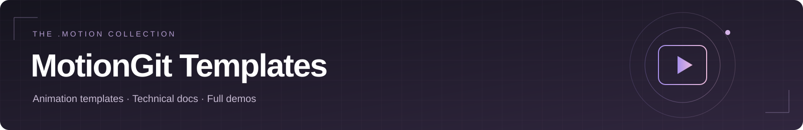

# MotionGit 模板合集

**29 个模板 · 30 个 Demo** · [在线播放全部 Demo](https://motiontemplates.github.io/all/) · [English](README.en.md)

浏览模板的实际样片、输出规格与技术资料。选择模板后，在对应页面查看素材要求和完整 `.motion`；取得模板后按包内 README 与制作指南制作。

[MotionGit](https://motiongit.com) · [.motion 格式说明](https://motiongit.com/spec)

## 开源体验

<h3><a href="https://motiongit.com/@adunext/385712">酷炫科技风 · 横屏</a></h3>

16:9 · 1920 × 1080 · 60 FPS v0.2.7-open-beta · 含开源 .motion 包

金属立体字、光效与空间动效；中英横屏、中文竖屏，支持简单人脸居中和圆形署名。

<a href="https://motiongit.com/@adunext/385712">https://motiongit.com/@adunext/385712</a>

<a href="https://motiontemplates.github.io/385712/assets/demo.mp4">▶ 完整 Demo</a> · <a href="https://github.com/motiontemplates/385712">GitHub 技术资料</a>

---

<h3><a href="https://motiongit.com/@adunext/385712">酷炫科技风 · 中文竖屏</a></h3>

9:16 · 1080 × 1920 · 60 FPS v0.2.19-open-beta · 官网中文竖屏

金属立体字、光效与空间动效；中英横屏、中文竖屏，支持简单人脸居中和圆形署名。

<a href="https://motiongit.com/@adunext/385712">https://motiongit.com/@adunext/385712</a>

官网中文竖屏 v0.2.19-open-beta；GitHub 开源包 v0.2.7-open-beta（16:9）。

<a href="https://media.openaicut.com/previews/626/0.2.9-open-beta-zh-11eae4868d37.mp4">▶ 完整 Demo</a> · <a href="https://github.com/motiontemplates/385712">GitHub 技术资料</a>

## 口播与讲解

<h3><a href="https://motiongit.com/@adunext/template-01-integrated">现代图文 · 口播讲解</a></h3>

16:9 · 1920 × 1080 · 60 FPS v2.6.0 · .motion

用现代图文版式、文字强调和信息拆解配合口播，适合观点、证据与步骤讲解。

<a href="https://motiongit.com/@adunext/template-01-integrated">https://motiongit.com/@adunext/template-01-integrated</a>

<a href="https://media.openaicut.com/previews/605/draft-en-eec61194c664.mp4">▶ 完整 Demo</a> · <a href="https://github.com/motiontemplates/336980">GitHub 技术资料</a>

---

<h3><a href="https://motiongit.com/@adunext/template-01-integrated-portrait">现代图文 · 口播讲解 · 竖屏</a></h3>

9:16 · 1080 × 1920 · 60 FPS v2.6.0 · .motion

用现代图文版式、文字强调和信息拆解配合口播，适合观点、证据与步骤讲解。

<a href="https://motiongit.com/@adunext/template-01-integrated-portrait">https://motiongit.com/@adunext/template-01-integrated-portrait</a>

<a href="https://media.openaicut.com/previews/606/draft-en-c6ecdaeb5d85.mp4">▶ 完整 Demo</a> · <a href="https://github.com/motiontemplates/314486">GitHub 技术资料</a>

---

<h3><a href="https://motiongit.com/@adunext/template-02-expanded">纸面透视 · 口播讲解</a></h3>

16:9 · 1920 × 1080 · 60 FPS v2.6.0 · .motion

用纸面透视、卡片层次和图文关系配合口播，适合方法拆解与结构化知识。

<a href="https://motiongit.com/@adunext/template-02-expanded">https://motiongit.com/@adunext/template-02-expanded</a>

<a href="https://media.openaicut.com/previews/607/draft-en-c751c296f78b.mp4">▶ 完整 Demo</a> · <a href="https://github.com/motiontemplates/358192">GitHub 技术资料</a>

---

<h3><a href="https://motiongit.com/@adunext/template-02-expanded-portrait">纸面透视 · 口播讲解 · 竖屏</a></h3>

9:16 · 1080 × 1920 · 60 FPS v2.6.0 · .motion

用纸面透视、卡片层次和图文关系配合口播，适合方法拆解与结构化知识。

<a href="https://motiongit.com/@adunext/template-02-expanded-portrait">https://motiongit.com/@adunext/template-02-expanded-portrait</a>

<a href="https://media.openaicut.com/previews/608/draft-en-a5200442ba79.mp4">▶ 完整 Demo</a> · <a href="https://github.com/motiontemplates/295450">GitHub 技术资料</a>

---

<h3><a href="https://motiongit.com/@adunext/template-03-native">深色立体 · 多屏展陈</a></h3>

16:9 · 1920 × 1080 · 60 FPS v2.6.0 · .motion

用深色立体舞台、多屏和空间层次展示口播内容，适合产品、案例与媒体素材讲解。

<a href="https://motiongit.com/@adunext/template-03-native">https://motiongit.com/@adunext/template-03-native</a>

<a href="https://media.openaicut.com/previews/609/draft-en-70e2fe808e0c.mp4">▶ 完整 Demo</a> · <a href="https://github.com/motiontemplates/304634">GitHub 技术资料</a>

---

<h3><a href="https://motiongit.com/@adunext/template-03-native-portrait">深色立体 · 多屏展陈 · 竖屏</a></h3>

9:16 · 1080 × 1920 · 60 FPS v2.6.0 · .motion

用深色立体舞台、多屏和空间层次展示口播内容，适合产品、案例与媒体素材讲解。

<a href="https://motiongit.com/@adunext/template-03-native-portrait">https://motiongit.com/@adunext/template-03-native-portrait</a>

<a href="https://media.openaicut.com/previews/610/draft-en-9785b0f9679c.mp4">▶ 完整 Demo</a> · <a href="https://github.com/motiontemplates/569615">GitHub 技术资料</a>

---

<h3><a href="https://motiongit.com/@adunext/template-04-dark-console">科技控制台 · 口播讲解</a></h3>

16:9 · 1920 × 1080 · 60 FPS v2.6.0 · .motion

用科技控制台、紫色玻璃质感与动态信息组件配合口播，适合技术与数据说明。

<a href="https://motiongit.com/@adunext/template-04-dark-console">https://motiongit.com/@adunext/template-04-dark-console</a>

<a href="https://media.openaicut.com/previews/611/2.5.7-en-688a5e4511ae.mp4">▶ 完整 Demo</a> · <a href="https://github.com/motiontemplates/553346">GitHub 技术资料</a>

---

<h3><a href="https://motiongit.com/@adunext/template-04-dark-console-portrait">科技控制台 · 口播讲解 · 竖屏</a></h3>

9:16 · 1080 × 1920 · 60 FPS v2.6.0 · .motion

用科技控制台、紫色玻璃质感与动态信息组件配合口播，适合技术与数据说明。

<a href="https://motiongit.com/@adunext/template-04-dark-console-portrait">https://motiongit.com/@adunext/template-04-dark-console-portrait</a>

<a href="https://media.openaicut.com/previews/612/2.5.7-en-4414b3f06c06.mp4">▶ 完整 Demo</a> · <a href="https://github.com/motiontemplates/738182">GitHub 技术资料</a>

---

<h3><a href="https://motiongit.com/@adunext/template-05-native">鲜色角色 · 叙事讲解</a></h3>

16:9 · 1920 × 1080 · 60 FPS v2.6.0 · .motion

用鲜明配色、角色素材与叙事动效配合口播，适合故事、观点和情境解释。

<a href="https://motiongit.com/@adunext/template-05-native">https://motiongit.com/@adunext/template-05-native</a>

<a href="https://media.openaicut.com/previews/613/draft-en-e06d1f42b0b9.mp4">▶ 完整 Demo</a> · <a href="https://github.com/motiontemplates/960723">GitHub 技术资料</a>

---

<h3><a href="https://motiongit.com/@adunext/template-05-native-portrait">鲜色角色 · 叙事讲解 · 竖屏</a></h3>

9:16 · 1080 × 1920 · 60 FPS v2.6.0 · .motion

用鲜明配色、角色素材与叙事动效配合口播，适合故事、观点和情境解释。

<a href="https://motiongit.com/@adunext/template-05-native-portrait">https://motiongit.com/@adunext/template-05-native-portrait</a>

<a href="https://media.openaicut.com/previews/614/draft-en-6f4079db7a76.mp4">▶ 完整 Demo</a> · <a href="https://github.com/motiontemplates/293151">GitHub 技术资料</a>

---

<h3><a href="https://motiongit.com/@adunext/vibrant-poster">活力海报 · 口播讲解</a></h3>

16:9 · 1920 × 1080 · 60 FPS v2.6.0 · .motion

用高对比海报、大字、清单和图形关系配合口播，含原生动画与新增组件，横屏独立编排。

<a href="https://motiongit.com/@adunext/vibrant-poster">https://motiongit.com/@adunext/vibrant-poster</a>

<a href="https://media.openaicut.com/previews/623/draft-en-e9dd279eebe9.mp4">▶ 完整 Demo</a> · <a href="https://github.com/motiontemplates/762139">GitHub 技术资料</a>

---

<h3><a href="https://motiongit.com/@adunext/vibrant-poster-portrait">活力海报 · 口播讲解 · 竖屏</a></h3>

9:16 · 1080 × 1920 · 60 FPS v2.6.0 · .motion

用高对比海报、大字、清单和图形关系配合口播，含原生动画与新增组件，竖屏独立编排。

<a href="https://motiongit.com/@adunext/vibrant-poster-portrait">https://motiongit.com/@adunext/vibrant-poster-portrait</a>

<a href="https://media.openaicut.com/previews/624/draft-en-42518fd309a1.mp4">▶ 完整 Demo</a> · <a href="https://github.com/motiontemplates/721489">GitHub 技术资料</a>

## 品牌与产品

<h3><a href="https://motiongit.com/@motiongit/motiongit-promo-main">多屏拼贴 · 品牌宣传</a></h3>

16:9 · 1920 × 1080 · 60 FPS v2.6.0 · .motion

用多屏拼贴、版面切换和品牌收尾展示产品与创作流程，适合品牌介绍和工具宣传。

<a href="https://motiongit.com/@motiongit/motiongit-promo-main">https://motiongit.com/@motiongit/motiongit-promo-main</a>

<a href="https://media.openaicut.com/previews/585/draft-en-3d2b6bdce3c7.mp4">▶ 完整 Demo</a> · <a href="https://github.com/motiontemplates/128610">GitHub 技术资料</a>

---

<h3><a href="https://motiongit.com/@motiongit/motiongit-promo-pixel">像素闯关 · 产品宣传</a></h3>

16:9 · 1920 × 1080 · 60 FPS v2.6.0 · .motion

像素城市、角色闯关和复古游戏音色组成产品介绍，适合数字工具与功能说明。

<a href="https://motiongit.com/@motiongit/motiongit-promo-pixel">https://motiongit.com/@motiongit/motiongit-promo-pixel</a>

<a href="https://media.openaicut.com/previews/586/draft-en-45375e2037e0.mp4">▶ 完整 Demo</a> · <a href="https://github.com/motiontemplates/252912">GitHub 技术资料</a>

---

<h3><a href="https://motiongit.com/@motiongit/motiongit-promo-velocity">明暗快切 · 产品宣传</a></h3>

16:9 · 1920 × 1080 · 60 FPS v2.6.0 · .motion

明暗画面快速切换，结合大字和界面展示突出产品功能，适合节奏鲜明的宣传片。

<a href="https://motiongit.com/@motiongit/motiongit-promo-velocity">https://motiongit.com/@motiongit/motiongit-promo-velocity</a>

<a href="https://media.openaicut.com/previews/587/draft-en-389d2163ab5f.mp4">▶ 完整 Demo</a> · <a href="https://github.com/motiontemplates/867595">GitHub 技术资料</a>

---

<h3><a href="https://motiongit.com/@motiongit/motiongit-promo-user">流程演示 · 产品教程</a></h3>

16:9 · 1920 × 1080 · 60 FPS v2.6.0 · .motion

沿着选择模板、提供内容、生成视频的流程讲解产品使用，适合工具教程和上手演示。

<a href="https://motiongit.com/@motiongit/motiongit-promo-user">https://motiongit.com/@motiongit/motiongit-promo-user</a>

<a href="https://media.openaicut.com/previews/588/draft-en-2422d5a878da.mp4">▶ 完整 Demo</a> · <a href="https://github.com/motiontemplates/670021">GitHub 技术资料</a>

---

<h3><a href="https://motiongit.com/@motiongit/motiongit-promo-creator">模块拼贴 · 创作者宣传</a></h3>

16:9 · 1920 × 1080 · 60 FPS v2.6.0 · .motion

以模块拼贴呈现内容、素材和动画的组合关系，适合创作者工具与工作方式介绍。

<a href="https://motiongit.com/@motiongit/motiongit-promo-creator">https://motiongit.com/@motiongit/motiongit-promo-creator</a>

<a href="https://media.openaicut.com/previews/589/draft-en-9fbec6ff121c.mp4">▶ 完整 Demo</a> · <a href="https://github.com/motiontemplates/452365">GitHub 技术资料</a>

---

<h3><a href="https://motiongit.com/@motiongit/motiongit-promo-blueprint">工程蓝图 · 产品拆解</a></h3>

16:9 · 1920 × 1080 · 60 FPS v2.6.0 · .motion

以工程蓝图、结构示意和模块拆解展示产品组成，适合技术产品与工作流讲解。

<a href="https://motiongit.com/@motiongit/motiongit-promo-blueprint">https://motiongit.com/@motiongit/motiongit-promo-blueprint</a>

<a href="https://media.openaicut.com/previews/590/draft-en-99059891101e.mp4">▶ 完整 Demo</a> · <a href="https://github.com/motiontemplates/213827">GitHub 技术资料</a>

---

<h3><a href="https://motiongit.com/@motiongit/motiongit-promo-keynote">发布会舞台 · 产品演示</a></h3>

16:9 · 1920 × 1080 · 60 FPS v2.6.0 · .motion

以发布会舞台和大屏展示组织产品演示，适合新品介绍、功能发布与品牌展示。

<a href="https://motiongit.com/@motiongit/motiongit-promo-keynote">https://motiongit.com/@motiongit/motiongit-promo-keynote</a>

<a href="https://media.openaicut.com/previews/591/draft-en-28eb07a5a332.mp4">▶ 完整 Demo</a> · <a href="https://github.com/motiontemplates/667934">GitHub 技术资料</a>

---

<h3><a href="https://motiongit.com/@motiongit/motiongit-promo-ink">宣纸手卷 · 品牌叙事</a></h3>

16:9 · 1920 × 1080 · 60 FPS v2.6.0 · .motion

沿宣纸手卷展开品牌故事，以水墨意象和卷轴转场营造东方叙事。

<a href="https://motiongit.com/@motiongit/motiongit-promo-ink">https://motiongit.com/@motiongit/motiongit-promo-ink</a>

<a href="https://media.openaicut.com/previews/592/draft-en-1f98c9f9df3c.mp4">▶ 完整 Demo</a> · <a href="https://github.com/motiontemplates/394243">GitHub 技术资料</a>

## 照片与视觉

<h3><a href="https://motiongit.com/@prism-studio/visual-art-a-halftone">半调网点 · 人像标题</a></h3>

16:9 · 1920 × 1080 · 60 FPS v2.6.0 · .motion

三张人像化为流动的双色网点，散开后重新汇聚成标题，适合人像与主题开场。

<a href="https://motiongit.com/@prism-studio/visual-art-a-halftone">https://motiongit.com/@prism-studio/visual-art-a-halftone</a>

<a href="https://media.openaicut.com/previews/615/draft-en-a549a50aa6eb.mp4">▶ 完整 Demo</a> · <a href="https://github.com/motiontemplates/381814">GitHub 技术资料</a>

---

<h3><a href="https://motiongit.com/@prism-studio/visual-art-b-mosaic">照片马赛克 · 拼图揭幕</a></h3>

16:9 · 1920 × 1080 · 60 FPS v2.6.0 · .motion

多张照片组成主视觉，从局部照片拉远揭示完整马赛克，适合集体回忆与拼图揭幕。

<a href="https://motiongit.com/@prism-studio/visual-art-b-mosaic">https://motiongit.com/@prism-studio/visual-art-b-mosaic</a>

<a href="https://media.openaicut.com/previews/616/draft-en-74fac1697ce7.mp4">▶ 完整 Demo</a> · <a href="https://github.com/motiontemplates/460349">GitHub 技术资料</a>

---

<h3><a href="https://motiongit.com/@prism-studio/visual-art-c-collage">几何拼贴 · 动态海报</a></h3>

16:9 · 1920 × 1080 · 60 FPS v2.6.0 · .motion

将四张照片裁成几何形状，在三组包豪斯动态海报中重组，适合活动与视觉主题展示。

<a href="https://motiongit.com/@prism-studio/visual-art-c-collage">https://motiongit.com/@prism-studio/visual-art-c-collage</a>

<a href="https://media.openaicut.com/previews/617/draft-en-b232ff8db7c6.mp4">▶ 完整 Demo</a> · <a href="https://github.com/motiontemplates/907345">GitHub 技术资料</a>

---

<h3><a href="https://motiongit.com/@prism-studio/visual-art-d-brushwork">笔触重绘 · 艺术照片</a></h3>

16:9 · 1920 × 1080 · 60 FPS v2.6.0 · .motion

用三层定向笔触重绘照片，与原图对照后呈现署名标题，适合摄影与艺术展示。

<a href="https://motiongit.com/@prism-studio/visual-art-d-brushwork">https://motiongit.com/@prism-studio/visual-art-d-brushwork</a>

<a href="https://media.openaicut.com/previews/618/draft-en-30b4688562e9.mp4">▶ 完整 Demo</a> · <a href="https://github.com/motiontemplates/328828">GitHub 技术资料</a>

---

<h3><a href="https://motiongit.com/@prism-studio/visual-art-e-glitch">信号故障 · 照片转场</a></h3>

16:9 · 1920 × 1080 · 60 FPS v2.6.0 · .motion

用像素排序、RGB 分离和扫描线改造照片，并以 CRT 关机效果收尾，适合科技视觉片段。

<a href="https://motiongit.com/@prism-studio/visual-art-e-glitch">https://motiongit.com/@prism-studio/visual-art-e-glitch</a>

<a href="https://media.openaicut.com/previews/619/draft-en-e3aaf5ab5ba1.mp4">▶ 完整 Demo</a> · <a href="https://github.com/motiontemplates/638039">GitHub 技术资料</a>

---

<h3><a href="https://motiongit.com/@prism-studio/visual-art-f-double">双重曝光 · 人像叠影</a></h3>

16:9 · 1920 × 1080 · 60 FPS v2.6.0 · .motion

以风景填充人像剪影，双层画面反向漂移，标题从薄雾显现，适合诗意人像叠影。

<a href="https://motiongit.com/@prism-studio/visual-art-f-double">https://motiongit.com/@prism-studio/visual-art-f-double</a>

<a href="https://media.openaicut.com/previews/620/draft-en-8b1d45590a57.mp4">▶ 完整 Demo</a> · <a href="https://github.com/motiontemplates/800829">GitHub 技术资料</a>

---

<h3><a href="https://motiongit.com/@prism-studio/visual-art-g-gallery">空间画廊 · 回忆相册</a></h3>

16:9 · 1920 × 1080 · 60 FPS v2.6.0 · .motion

穿行带有文字说明的立体照片画廊，最后推进主照片并揭示全屏标题，适合回忆与作品集。

<a href="https://motiongit.com/@prism-studio/visual-art-g-gallery">https://motiongit.com/@prism-studio/visual-art-g-gallery</a>

<a href="https://media.openaicut.com/previews/621/draft-en-d730d56fb8f4.mp4">▶ 完整 Demo</a> · <a href="https://github.com/motiontemplates/743702">GitHub 技术资料</a>

---

<h3><a href="https://motiongit.com/@prism-studio/visual-art-h-kaleido">镜像万花筒 · 照片变幻</a></h3>

16:9 · 1920 × 1080 · 60 FPS v2.6.0 · .motion

将两张照片镜像成旋转的十二分段万花筒，经扩张圆环转场再展开原图，适合视觉主题片。

<a href="https://motiongit.com/@prism-studio/visual-art-h-kaleido">https://motiongit.com/@prism-studio/visual-art-h-kaleido</a>

<a href="https://media.openaicut.com/previews/622/draft-en-660c051c4b14.mp4">▶ 完整 Demo</a> · <a href="https://github.com/motiontemplates/551805">GitHub 技术资料</a>

---

本合集从已审核、免费公开且已验证的模板主页自动更新。技术原理、许可、素材要求与依赖以各模板页面和包内指南为准。
